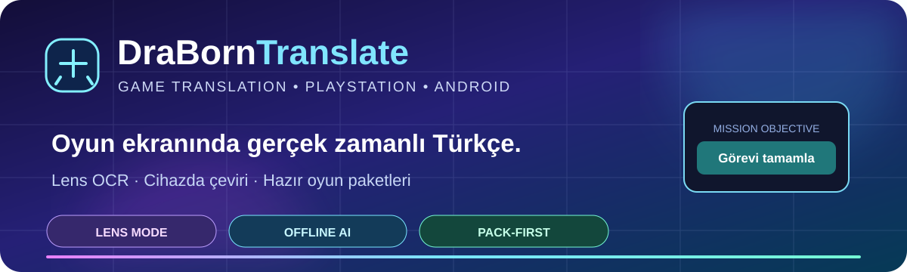

  

<h1 align="center">🎮 DraBornTranslate</h1>

<strong>PlayStation oyunları için canlı Türkçe altyazı, Lens modu ve hazır oyun paketleri.</strong>

  
  
  
  
  

  <a href="https://github.com/DrabornEagle/DraBornTranslate/releases/latest"><strong>📥 Son imzalı APK</strong></a> ·
  <a href="docs/KURULUM.md"><strong>📘 Kurulum</strong></a> ·
  <a href="https://github.com/DrabornEagle/DraBornTranslate/actions"><strong>⚙️ Derlemeler</strong></a> ·
  <a href="https://github.com/DrabornEagle/DraBornTranslate/issues"><strong>🐛 Destek</strong></a>

> **Sürüm durumu:** Kaynak kodu **v0.4.13**. Son yayımlanan, eski APK'larla imza uyumluluğu doğrulanmış dağıtım **v0.4.11**. v0.4.13 imzalı Release APK henüz yayımlanmadı. GitHub Actions Debug APK'sı mevcut uygulamanın üzerine kurulabilen Production Release APK değildir.

> **🚧 v5.0 geliştirme çalışması:** GameTranslator v1.8.51 kaynak motorunun kısa konuşma karşılıkları ve Türkçe son düzenleme kuralları mevcut çeviri hattına bağlandı. Resmî GitLab sürümlerini izleyen otomatik kaynak senkronu ve uygulama içi kontrol ekranı eklendi. Flutter/Chiaki/TV modüllerinin tamamının tek APK'da entegrasyonu **henüz tamamlanmadı**; bu nedenle v5.0 imzalı kararlı APK yayımlandığı iddia edilmez. [v5.0 entegrasyon ayrıntıları](docs/INTEGRATION-v5.0.md).

## 🎮 v5.1 · GameTranslator Android uyarlaması

**Yeni geliştirme sürümü: v5.1.0.** GameTranslator v1.8.50 Android ikili sürümünden hazırlanan DraBornTranslate uyarlamasında Android uygulama kimliği ve adı yeniden düzenlendi; **yeni RSA-3072 keystore** ile ayrı bir APK imzalandı. Bu uygulama, kaynak kodu temel alınarak tamamı sıfırdan yeniden derlenmiş birleşik Kotlin/Flutter uygulama **değildir**. Gerçek Android telefon / PS5 testi yapılmadı. Özel keystore ve APK bu GitHub deposuna yüklenmedi.

| Öğe | Kaynak / durum |
|---|---|
| Android uygulama adı | **DraBornTranslate**, sürüm **5.1.0** |
| GameTranslator tabanlı Android özellikleri | PS5/Chiaki, oyun paketleri, OCR, TV bağlantısı kodu (orijinal v1.8.50 derlemesinde) |
| GTA 6 Türkçe paketi | **İnternetten isteğe bağlı indirme; APK'da 475 bin satır gömülü değil.** Sunucudaki gerçek kapsam doğrulanamadı |
| Kaynak sürümü | GameTranslator **v1.8.51**, resmi lisanslı kaynak aynası |
| İmza | **Yeni sertifika**; eski DraBornTranslate kurulumu üzerine yüklenemez |
| Tam kod derlemesi / cihaz doğrulaması | **Devam ediyor; tamamlanmış sayılmaz** |

[**v5.1 teknik açıklama ve kurulum**](docs/RELEASE-v5.1.md) · [**v5.1 kaynak yeniden markalama betiği**](scripts/prepare_gametranslator_full_v5_1.py) · [**GameTranslator kaynakları**](upstream/GameTranslator) · [**GTA 6 paketi hakkında**](docs/RELEASE-v5.1.md#gta-6-translation-pack)

---

## 🚀 v5.0 · GameTranslator Entegrasyon Programı

**v5.0 geliştirmesi başladı; bu başlık imzalı v5.0 APK'sı yayımlandığı anlamına gelmez.** DraBornTranslate kendi uygulama kimliği, tasarımı, Lens/Portal özellikleri ve yerel çeviri motoruyla korunuyor.

| Geliştirme | Durum |
|---|---|
| GameTranslator v1.8.51 kaynak ağacı (1.694 dosya) | ✅ `upstream/GameTranslator` altında |
| Kısa oyun cümleleri ve Türkçe metin düzeltme motoru | ✅ Mevcut Kotlin çeviri hattına bağlı |
| GameTranslator kaynak sürümü kontrolü | ✅ Hakkında penceresinde |
| GitLab yeni sürüm kaynaklarını günlük eşitleme | ✅ GitHub Actions; yalnızca lisanslı kaynak kodu |
| Flutter ekranları + Chiaki/PS5 ve TV modüllerini aynı APK'da çalıştırma | 🚧 Geliştirme gerekiyor |
| Orijinal sertifikayla imzalı v5.0 Android Release | ⏳ Henüz yayımlanmadı |

**Kaynak takibi:** Resmî GitLab sürümü çıktığında kaynak kod otomatik eşitlenir. Yeni özelliklerin çalışan Android uygulamasına aktarılması, test edilmesi ve imzalı sürüm hazırlanması ayrı aşamalardır. [v5.0 değişiklik notları](docs/CHANGELOG-v5.0.md) · [Entegrasyon mimarisi](docs/INTEGRATION-v5.0.md)

## ✨ Özellikler

| Özellik | Açıklama |
|:---|:---|
| 🟣 **Lens modu** | Oyundaki menü, görev ve İngilizce yazıyı OCR ile bulup Türkçe karşılığını telefon ekranına yerleştirir |
| 🩵 **Canlı diyalog çevirisi** | Ekranda görünen İngilizce altyazıyı Türkçeye çevirir |
| 💚 **Paket öncelikli altyazı** | Hazır pakette eşleşme varsa yapay zekâ modelini beklemeden çeviriyi getirir |
| ⚡ **GTA 6 paket indirme** | GameTranslator'ın v1.8.50 paket sunucusundaki Türkçe paketi isteğe bağlı indirir, SHA-256 ile doğrular |
| 🧩 **Cihazda çalışan model** | Google ML Kit EN→TR ile Töz/ONNX yedeği; ücretli çeviri API anahtarı gerekmez |
| 🌐 **PS Portal yan panel** | Deneysel metin paneli bağlantısı; Portal'da görüntüleme ve sabitleme garanti değildir |

## 🎮 Paket öncelikli GTA 6 altyazısı

~~~text
İngilizce oyun görüntüsü
         │
         ▼
    OCR + metin takibi
         │
         ▼
  Türkçe oyun paketini ara
       /            \
    Eşleşti       Eşleşmedi
       |              |
       ▼              ▼
 Paketten getir   Yerel AI çevir
       \              /
        ▼            ▼
       Türkçe altyazı / Lens
~~~

GameTranslator'ın **v1.8.50** sürüm notları, GTA 6 Türkçe paketinde **yaklaşık 475.000 satır** bulunduğunu iddia ediyor. Bu sayı **bağımsız olarak doğrulanmış değildir**. DraBornTranslate paketi APK içine veya GitHub'a gömmez. Uygulama, sunucuda mevcutsa kullanıcının isteğiyle indirir, dosyanın SHA-256 özetini kontrol eder ve ayrıştırılan satır sayısını gösterir. Çeviri kapsamı ile doğruluğu garanti edilmez.

## 🚀 Nasıl kullanılır?

1. [Son yayımlanan Android APK](https://github.com/DrabornEagle/DraBornTranslate/releases/latest) sürümünü indir. v0.4.13 kaynak kodu için [Actions önizleme derlemesine](https://github.com/DrabornEagle/DraBornTranslate/actions/workflows/android.yml) bak.
2. **Oyun kaynağı:** PS Portal / PlayStation App veya Telefonda oyna / PS Remote Play seç.
3. **Çevrilecek alan:** Altyazı bölgesi, Tüm oyun metinleri veya **Lens · Yazının üzerine çevir** seç.
4. **Görünüm ve oyun paketi → Oyun paketi → 🎮 GTA 6 Türkçe paketini indir / güncelle** yolunu kullan.
5. Ekran paylaşımı iznini ver, oyun görüntüsünü telefonda açık tut ve canlı çeviriyi başlat.

> **Önemli:** Lens katmanı **Android telefonundaki** oyun görüntüsüne eklenir. PlayStation Portal'ın fiziksel ekranını doğrudan değiştirmez. Portal yan panel yöntemi deneysel olmaya devam ediyor. OCR, yalnızca görüntüde **yazılı** olan konuşmaları çevirebilir.

## 🛡️ Güvenlik ve üretim imzası

- **Test:** GitHub Actions her değişiklikte birim test, lint ve Debug APK derlemesi çalıştırır.
- **Güncelleme uyumluluğu:** v0.4.11 ile aynı sertifikayı üreten keystore olmadan yeni bir APK'yı mevcut kurulumun üzerine güvenli güncelleme olarak sunmuyoruz.
- **Paket güvenliği:** İndirme boyut sınırı, sunucu SHA-256 kontrolü ve başarısız güncellemede eski paket dosyasını koruyan kurulum.
- **Gizlilik:** Paket içeriği DraBornTranslate tarafından ayrı bir sunucuya yüklenmez; model çevirisi cihazda yapılır. Paket indirilirken üçüncü taraf GameTranslator sunucusuyla ağ bağlantısı kurulur.

### Kaynak koddan Android derleme

JDK 17 + Android SDK 35, ARM64:

~~~bash
./gradlew --no-daemon -PtargetAbi=arm64-v8a :app:testDebugUnitTest :app:lintDebug :app:assembleDebug
~~~

Üretilen önizleme dosyası: <code>app/build/outputs/apk/debug/app-debug.apk</code>.

## ⚖️ Lisans ve kaynak

DraBornTranslate AGPL-3.0 kapsamındaki [CouchSubs](https://github.com/yorulmazsinan/couchsubs) ve [Sefflex/GameTranslator](https://gitlab.com/sefflex/GameTranslator) bileşenlerinden uyarlanmış kaynakları da içerir. İlgili telif ve lisans bildirimleri [LICENSE](app/src/main/assets/LICENSE) ve [NOTICE](app/src/main/assets/NOTICE) içindedir. GameTranslator sunucusu bağımsız üçüncü taraf hizmetidir; DraBornTranslate onun resmî uygulaması değildir.

Oyun senaryosu ve çeviri paketlerinin yeniden dağıtım hakkı, kodun açık kaynak lisansıyla otomatik olarak verilmiş değildir. Bu nedenle üçüncü taraf GTA 6 paketi depoya veya APK'ya kopyalanmaz.

---

<strong>DrabornEagle ecosystem 💜 · Made for gamers</strong>

<a href="https://www.draborneagle.com">Website</a> · <a href="https://github.com/DrabornEagle">GitHub</a> · <a href="https://github.com/DrabornEagle/DraBornTranslate/issues">Feedback</a>

