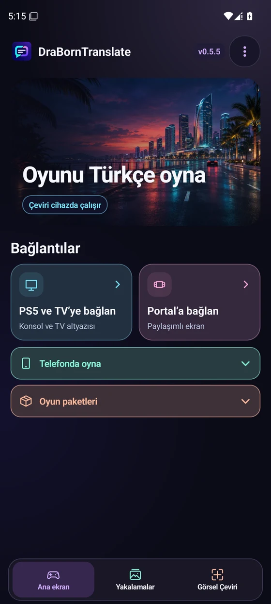
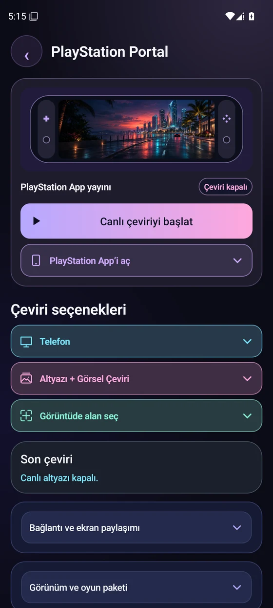

  
    
  
  <h1>DraBornTranslate</h1>
  
<strong>PlayStation oyunlarını Türkçe oku.</strong> Canlı altyazı, oyun içi metin çevirisi ve PS App yakalamaları.

  
  
  
  
İmzalı APK · Android 10+ · ARM64

## GTA 6 profili

**Portal’a bağlan → Oyun profili → GTA 6** yoluyla altyazı, görev, ipucu, mesaj bildirimi ve oyun içi telefon alanlarını otomatik seç. Telefon paneli için sohbet balonlarını veya sade görünümü seçebilirsin. Çevirileri Portal panelinde de görmek için **Telefon ve Portal paneli** çıkışını seç.

GTA 6 canlı altyazı paketi ilk altyazıdan itibaren önceliklidir. Aynı repliğin bozuk okunan bir karesi pakette bulunamadığında ekrandaki doğru çeviri korunur.

**Capiche · Türkçe dublaj** GTA 6 profilinden ve konsol ayarlarından açılır. Konsolun ham oyun görüntüsü aynı ağdaki bilgisayarda bir tarayıcı penceresine aktarılabilir. Dublajı Capiche’nin masaüstü sayfası yürütür. Duraklatma menüsündeki sol liste oyuna dönünce ilk yeni okumada kapanır. [Capiche kurulum adımları](docs/KURULUM.md#capiche-ile-t%C3%BCrk%C3%A7e-dublaj)

## GTA 6 Görev Ara/Oku

Görev Ara/Oku, görevleri Türkçe ve İngilizce ad, harita başlığı ve teknik kodla bulur. **Meet Raul’s Crew** araması **Credit Check** görevini açar.

**Görev Metinleri → Konuşmalar**, kayıtlarla eşleştirilen sahneleri görev akışıyla gösterir. Sahne türü, karakter adı ve sahne görselleri ilgili metnin yanında yer alır. **Sahnelere göre** ve **Hızlı Oku** aynı sırayı kullanır. **Daha Fazla Oku** sıradaki replikleri açar. Görev Detayı başlığının sağındaki ok sayfanın başına döner. [v0.7.13 kaynak dosyaları ve derleme adımları](releases/v0.7.13/README.md)

## Uygulamadan · v0.5.5

<table>
  <tr>
    <th>Ana ekran</th>
    <th>PlayStation Portal</th>
  </tr>
  <tr>
    <td align="center"></td>
    <td align="center"></td>
  </tr>
</table>

## Oyun görüntüsünü bağla

| Oynadığın yer | Ana ekrandaki seçenek | Çeviri |
| --- | --- | --- |
| PS5 ve TV | **PS5 ve TV’ye bağlan** | Telefon ya da aynı ağdaki TV tarayıcısı |
| PlayStation Portal | **Portal’a bağlan** | PlayStation App yayını, telefon ya da desteklenen Portal yan paneli |
| Telefondaki PS Remote Play | **Telefonda oyna** | Oyun görüntüsünün üzerinde altyazı |

- **Canlı altyazı** oyun metnini telefonda okur ve Türkçeye çevirir. **Oyun paketleri → GTA 6 altyazı paketini indir** yoluyla GTA 6 canlı altyazı paketini ekleyebilirsin. Pakete uyan satırlar yerel tablodan, diğer metinler cihazdaki Töz-Çevir modelinden gelir.
- **Görsel Çeviri** görüntüde seçtiğin alanın Türkçesini kareye yerleştirir. Kareyi tam ekranda yakınlaştırabilir ve orijinal görüntüye geçebilirsin.
- **Güncel oyun karesini al** açık oturumdaki son kareyi getirir. Kare yoksa görüntü kaynağını seçebilirsin. Kayıtlı fotoğraflar ve klipler **Yakalamalar** bölümünden açılır.
- **Yakalamalar** PS App’ten indirilen fotoğraf ve klipleri listeler. **Paylaş → DraBornTranslate** ile bir yakalamayı doğrudan açabilir, klipte çevrilecek kareyi seçebilirsin.

## İndir ve kur

1. [DraBornTranslate v0.7.13 imzalı APK’yı indir](https://github.com/DrabornEagle/DraBornTranslate/releases/download/v0.7.13/DraBornTranslate-v0.7.13-Kisisel-Android-arm64.apk).
2. APK’yı Android telefonunda aç. Önceki v5 serisi kurulumunun üzerine yükleyebilirsin.
3. Ana ekrandan bağlantını seç. [PS5, Portal ve Remote Play kurulum adımları](docs/KURULUM.md).

## Derleme ve kaynaklar

[Android derlemesi](https://github.com/DrabornEagle/DraBornTranslate/actions/workflows/android.yml) · [Bu sürümün kaynakları ve derlemesi](releases/v0.7.13/README.md) · [Çeviri bileşeni eşitleme](https://github.com/DrabornEagle/DraBornTranslate/actions/workflows/translation-sync.yml)
