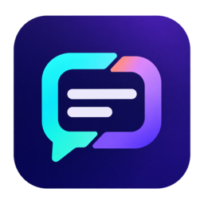

  
  <h1>DraBornTranslate</h1>
  
<strong>PlayStation oyunlarını Türkçe oku</strong>

  
  
  

## Oyunu aç, bağlantıyı seç

| Nerede oynuyorsun? | Uygulamadaki seçenek | Türkçeyi nerede okursun? |
| --- | --- | --- |
| PS5 ve TV | **PS5 ve TV’ye bağlan** | Telefon veya aynı ağdaki TV tarayıcısı |
| PlayStation Portal | **Portal’a bağlan** | Telefon veya desteklenirse Portal yan paneli |
| Telefondaki PS Remote Play | **PS5 ve TV’ye bağlan → PS Remote Play ile telefonda oyna** | Oyunun üzerindeki Android altyazı katmanı |

### Altyazı + DraBorn Odak

Altyazılar akarken oyun telefonundaki mesajı, tabelayı veya Brief metnini seç. **DraBorn Odak** Türkçeyi okuduğu görüntünün üstüne yerleştirir ve çevirinin tamamını metin olarak da gösterir. Android 14 ve üzerindeki uygulama paylaşımında seçili alan canlı olarak yenilenebilir.

**GTA 6 Türkçe paketini al** seçeneği Türkçe oyun paketini telefona indirir. Pakette eşleşen replikler yerel olarak döner. Diğer metinleri telefondaki Töz-Çevir modeli çevirir. Çeviri için hesap, ücretli servis, kamera, mikrofon veya bilgisayar gerekmez.

### PS App yakalamaları

PS App’ten telefona indirilen görüntüler **PS App yakalamaları** bölümünde açılır. **Otomatik çeviriyi aç** seçildiğinde Android’in erişim verdiği PS App klasörlerindeki yeni dosyalar sıraya alınır. Bir klipte ilerleme çubuğuyla Brief’in göründüğü kare seçilebilir.

## İndir ve kur

[İmzalı DraBornTranslate v5.0 APK](https://github.com/DrabornEagle/DraBornTranslate/releases/download/v5.0/DraBornTranslate-v5.0-Android-arm64.apk) · [Sürüm notları](https://github.com/DrabornEagle/DraBornTranslate/releases/tag/v5.0) · [Kurulum rehberi](docs/KURULUM.md)

Android 10 ve üzeri ARM64 telefonlar desteklenir. v5.0, Android sürüm kodu 1 ile yeni paket kimliğine kurulur ve önceki DraBornTranslate sürümüyle yan yana kullanılabilir. v5 serisinin güncellemeleri ana ekrandaki **Yeni sürüm kontrolü** üzerinden indirilir.

## Güncellemeler ve kaynak kodu

[Çeviri bileşeni eşitleme](https://github.com/DrabornEagle/DraBornTranslate/actions/workflows/translation-sync.yml) yeni kaynak sürümünü saatte bir kontrol eder. Android’e ait bileşenler derleme ve testlerden geçtiğinde depo güncellenir. Uygulamanın güncelleme ekranı, bu depodaki imzalı GitHub sürümlerini takip eder.

- [Android derlemesi ve testler](docs/KURULUM.md#kaynak-koddan-derleme)
- [Açık kaynak lisansı](app/src/main/assets/LICENSE) · [Telif bildirimleri](app/src/main/assets/NOTICE) · [Bileşenler](docs/KAYNAKLAR.md)
